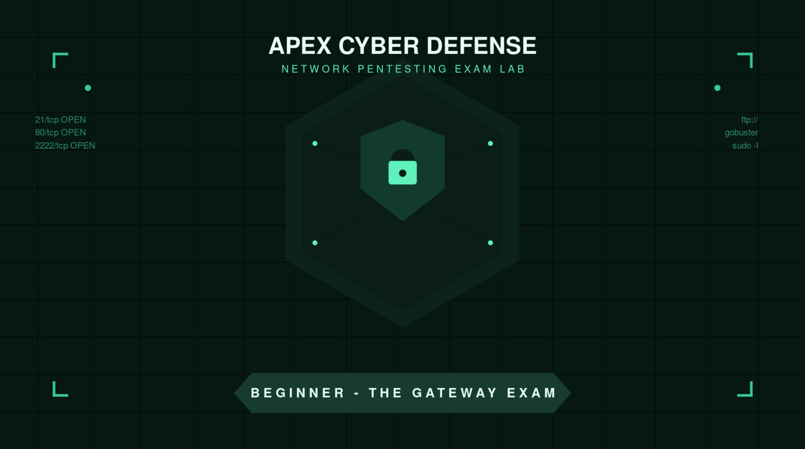

# Apex Cyber Defense - Network Pentesting Exam Lab



**Difficulty: Beginner-equivalent.** A standalone box -- not part of
[The Halcyon Protocol](https://github.com/A3lxq?tab=repositories&q=synnefo-)
series and not the Synnefo Academy universe either (a different setting
again: a corporate "Apex Cyber Defense" network-pentesting exam), but
ranked on the same scale: comparable depth to that series' Beginner
tier, spanning network reconnaissance (full-port Nmap scanning), web
OSINT (reading page source for a leaked username and flag), wordlist
generation and credential brute-forcing (CeWL + Hydra against FTP),
loot-driven web directory enumeration, image-metadata key extraction
(a base64 OpenSSH key hidden in a PNG), SSH key authentication on a
non-standard port, and Linux privilege escalation via a sudo/GTFOBins
misconfiguration. 4 flags in total -- web recon, SSH user shell, a
third flag also dropped as a plain file over the same FTP session, and
root compromise.

A complete, self-contained offensive security exam environment designed to test network reconnaissance, web-based password profiling, authentication protocol analysis, and Linux privilege escalation.

## Quick Links
- [Student Exam Handout](docs/EXAM_BRIEF_FOR_STUDENTS.md)
- [Instructor Manual & Grading Rubric](docs/INSTRUCTOR_MANUAL.md)
- [Complete Solution Walkthrough](docs/SOLUTION_WALKTHROUGH.md)

---

## Architecture at a Glance
- **Target OS:** Debian / Ubuntu
- **Open Ports (Only 3):**
  - `80/tcp` (HTTP Web Server)
  - `21/tcp` (vsftpd FTP Gateway)
  - `2222/tcp` (OpenSSH - Custom Port; Port 22 is disabled)
- **Flags:**
  - `Flag 1`: Web Recon (`FLAG{w3b_r3c0n_us3rn4m3_f0und_9482}`) -- also in `flag1.txt`
  - `Flag 2`: SSH User Shell (`FLAG{ssh_k3y_auth_p0rt_2222_pwn3d_1834}`) -- also in `flag2.txt`
  - `Flag 3`: dropped alongside the others as `flag3.txt`
  - `Flag 4`: Root Compromise (`FLAG{r00t_gtf0b1n5_pr1v3sc_succ3ss_8821}`), in `/root/root.txt`
  - On this static box, `flag3.txt` and `root.txt` happen to hold the
    same value (an authoring quirk on the original OVA, found by
    diffing the two files). The per-team rebuild in `ctf-orchestrator`
    (`bonus-apex-cyber-defense`) derives all 4 independently instead.

---

## Quickstart

### 1. Launch via Docker Compose
```bash
docker compose up -d --build
```

### 2. Launch on a Standalone Ubuntu/Debian VM
```bash
sudo bash setup-exam.sh
```

### 3. Verify Open Ports from Attacker Host
```bash
nmap -p- <TARGET_IP>
```
